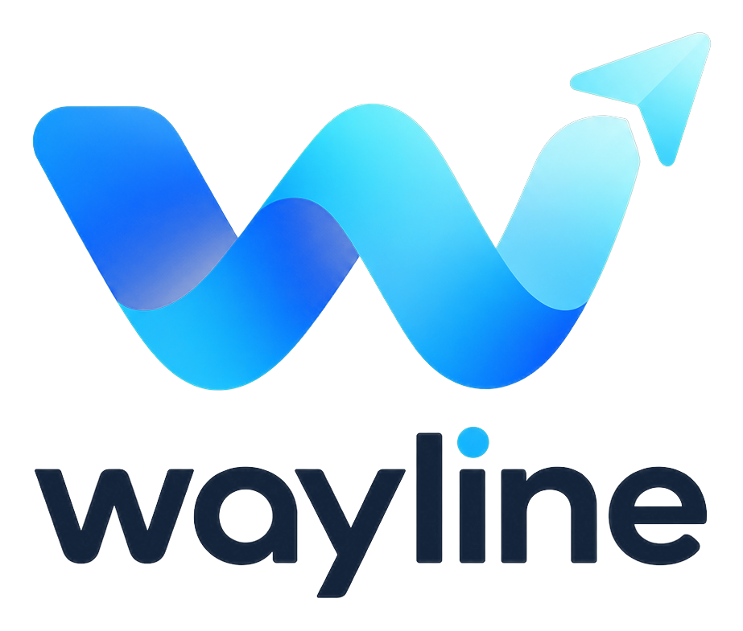
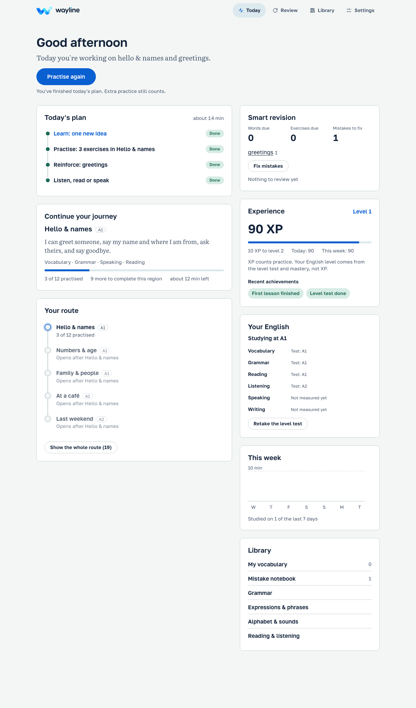
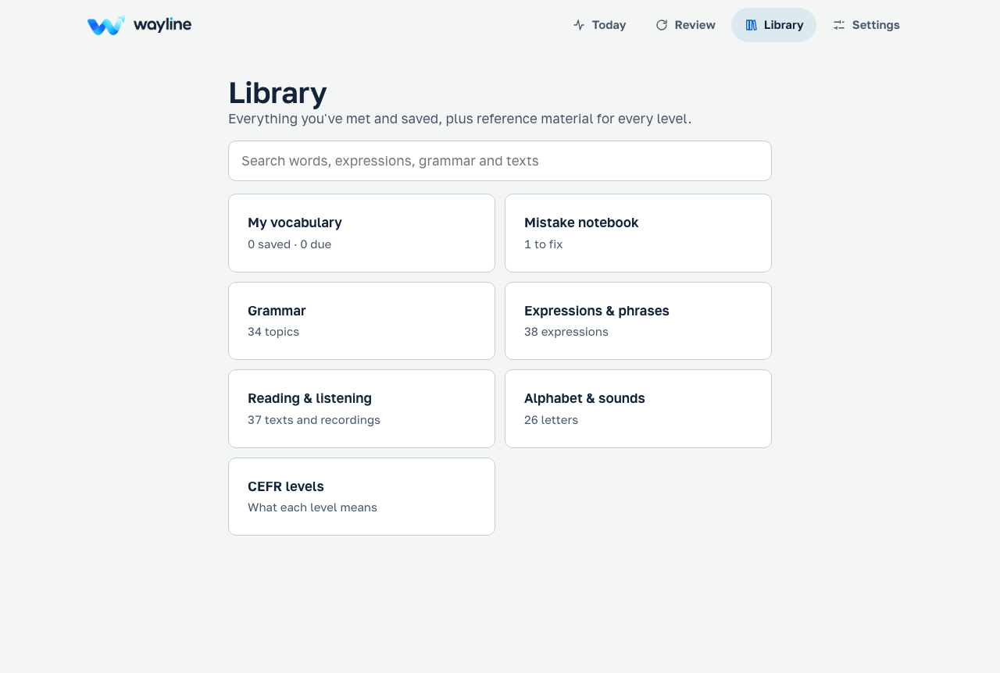
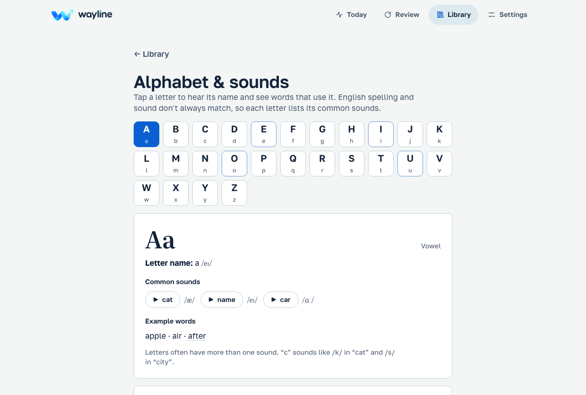

<p align="center">
  
</p>

<p align="center"><strong>A free, local-first English course from Pre-A1 to C2.</strong><br>
Adaptive level test · personal daily plan · speaking practice · a library that grows as you learn.</p>

---

Wayline places each learner with an adaptive test, then builds a daily plan around their level, goals and mistakes. It runs entirely in the browser: no account, no server, no paid APIs. Progress is stored on the learner's device and can be backed up to a file.

Explanations are available in **English** and **Bulgarian**; the learner picks which one at the start.

## Product tour

<p align="center">
  
</p>

<p align="center">
  
  
</p>

These screenshots are generated by the repository's Playwright screenshot flow using local sample progress; they do not contain learner data.

## What's inside

| Area | What it does |
| --- | --- |
| **Level test** | Adaptive A1–C2 test (Rasch model, 12–30 questions) across grammar, vocabulary, reading, listening and functional language. Reports a level, a range, per-skill estimates and what wasn't assessed. An extended test is available when the result is uncertain. |
| **Daily plan** | Warm-up reviews → one new idea → practice → reinforcement of the learner's own mistakes → listening, reading or speaking. Sized to 10, 20, 30 or 45 minutes. Every step has a stated reason. |
| **Learner model** | Tracks accuracy per skill, placement results, goals, focus skills and recurring mistake topics, and uses them to choose what comes next. Deterministic: the same data gives the same plan. |
| **Review** | FSRS-6 spaced repetition for words, expressions and exercises. Words move New → Learning → Reviewing → Strong → Mastered by recall over time, never after one answer. After a break, reviews are capped so nothing piles up. |
| **Speaking** | Listen-and-repeat, read aloud, answer a question, and dialogues with distinct character voices. Records with the microphone, plays your recording next to the model, and can check which words were recognised. |
| **Library** | Search; My vocabulary with history; 36 curated expressions with register and usage; grammar by level; interactive alphabet; mistake notebook; reading and listening; CEFR reference. Any exercise can be practised from here. |
| **Dashboard** | Today's plan, revision due, XP and achievements, skill profile, journey, weekly activity and insights — all from real activity. |
| **XP** | An idempotent ledger: reloading or repeating never pays twice. XP measures practice; it never changes your English level. |

## Privacy

- Everything is stored in the browser (IndexedDB). There are no accounts, analytics or third-party requests.
- Microphone recordings stay in memory for the current exercise and are discarded when you leave it.
- **Speech recognition is opt-in.** Wayline uses on-device recognition where the browser offers it (Chrome 139+ desktop). Where the only option sends audio to the browser maker's servers, it asks for explicit consent first, and works without recognition if you say no.
- Word checks report which words were recognised. They are **not** a pronunciation score.

## Run it locally

Requires Node 22.

```bash
npm install
npm run dev          # http://localhost:5173
```

| Command | What it does |
| --- | --- |
| `npm run check` | Typecheck, lint, unit tests, production build |
| `npm test` | Unit tests: placement, planner, learner model, XP, FSRS, migrations, backup, content validation, colour contrast |
| `npm run test:content` | Validate every content pack |
| `npm run test:e2e` | Playwright on Chromium, Firefox, WebKit, Pixel 7 and iPhone 15 (run `npm run build` first) |
| `npm run build:artifact` | Single-file HTML build for sharing as a Claude artifact |
| `npm run brand` | Regenerate logo, icons and favicon from `brand-src/wayline-logo.png` (needs Python + Pillow) |

Run the browser tests against a deployed site with `BASE_URL=https://… npm run test:e2e`.

## Project structure

```
src/
  app/          Routes, app shell, update prompt
  components/   Exercises (classic, speak, listen, dialogue), Word Lens, recorder, logo
  content/      Content schema + validator, lesson packs (JSON), diagnostic bank,
                expressions, alphabet, CEFR reference
  db/           Dexie schema with versioned migrations, backup/restore
  engine/       Placement, planner, learner model, XP, dashboard data, answer checking
  i18n/         Interface strings (en, bg), topic names
  lib/          FSRS, speech synthesis, microphone, speech recognition
  pages/        Onboarding, placement, dashboard, sessions, library, settings
  styles/       Design tokens (light/dark), global CSS, contrast test
e2e/            Playwright journeys
docs/           Upgrade audit, status and known limitations
scripts/        Brand assets, artifact build
```

## Content

Lessons are JSON packs in `src/content/packs`, validated against `src/content/schema.ts`. Exercises are in English; explanations, hints and titles are `{ "en": "…", "bg": "…" }` and fall back to English. The validator fails the build on schema errors, duplicate ids, unknown references, prerequisite cycles and out-of-range answers.

Current coverage: Pre-A1 letters, A1 lessons, two lessons per band from A2 to C2, and a speaking/listening/dialogue lesson per band. **All content is marked draft** and needs review by a native-speaker teacher. See [CONTRIBUTING.md](CONTRIBUTING.md).

The automated validator checks structure and internal consistency, not whether a lesson is pedagogically complete or naturally worded. Do not treat the current content as a teacher-reviewed full course.

## Data safety

Schema changes go through versioned Dexie migrations that only add data. A unit test and a browser test open a database from the previous version and check that every profile, card, mistake and activity row survives. Learners can export a backup file and restore it on any device.

## Known limitations

- Voices depend on what the device has installed; some devices have only one English voice. Voices are labelled male or female only when the voice name is on a verified list.
- On-device speech recognition is limited to recent desktop Chrome. Microphone flows are tested with Chromium's fake audio device and a simulated recogniser, which proves the interface, not real hardware.
- Writing and speaking are not part of the level test.
- Content is a representative slice per level, not a full syllabus.

Full list: [docs/UPGRADE.md](docs/UPGRADE.md).

## Deployment

Static build (`dist/`) with SPA rewrites and security headers in `vercel.json`. Vercel's Hobby plan is for non-commercial use; move to Pro (or another static host) before any monetisation.

## Licence

Source code: proprietary, all rights reserved — see [LICENSE](LICENSE). The Wayline name and logo are not licensed for reuse. Third-party fonts and libraries: see [ATTRIBUTIONS.md](ATTRIBUTIONS.md).
